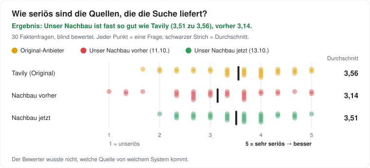
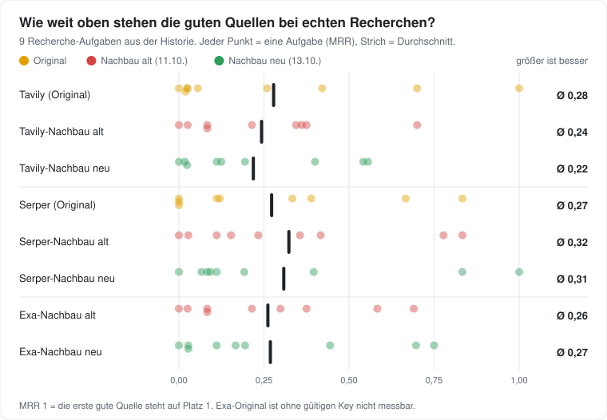
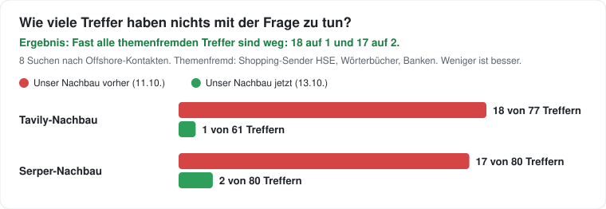
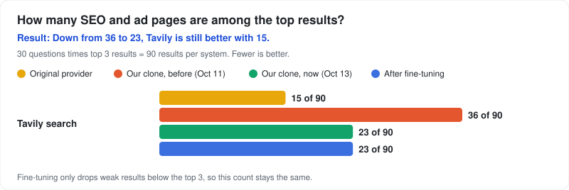
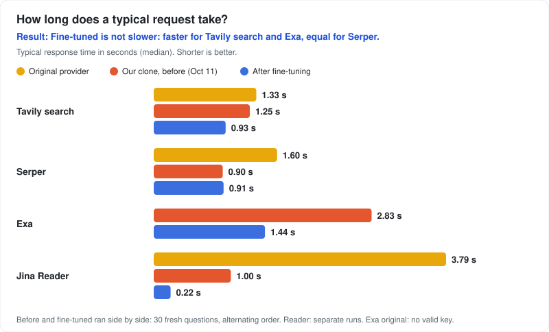
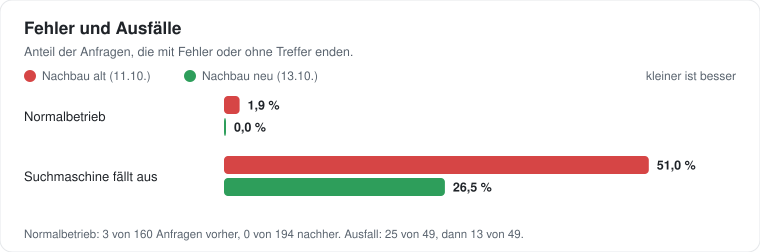
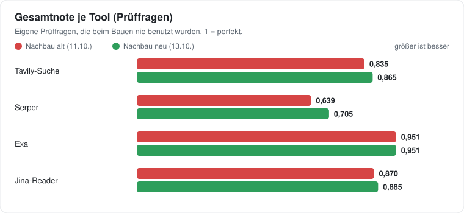
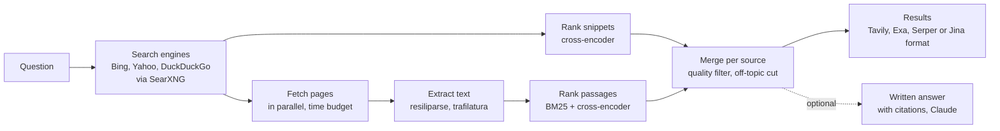

# tavily-clone

**Web search for AI agents.** Ask a question and get back the best sources, each with the
passage that answers it, in under a second. The service speaks the API formats of Tavily,
Exa, Serper and Jina Reader, so code written for those tools keeps working: change the
base URL, keep the client. There is no per-query bill, because it runs its own search
backend and ranking model.

```
POST /search  {"query": "When did the Berlin Wall fall?"}

1. Fall of the Berlin Wall - Wikipedia                     score 0.94
   "The Berlin Wall fell on 9 November 1989 during the Peaceful Revolution …"
2. Berlin Wall: History, Dates & Fall | HISTORY             score 0.94
3. Berlin Wall History Timeline: Complete 1961-1989 Guide   score 0.90
                                                             0.92 s
```

## What you can call

| Endpoint | Works like | What it does |
|---|---|---|
| `POST /search` | Tavily Search | Ranked sources with the answering passage, optional written answer with citations |
| `POST /extract` | Tavily Extract | Full clean text of up to 20 pages at once |
| `POST /exa/search`, `/exa/contents`, `/exa/findSimilar` | Exa | Search with highlights, page contents, "more pages like this one" |
| `POST /serper/search`, `/serper/news` | Serper | Google-style result lists and news |
| `GET /jina/r/{url}`, `GET /jina/s/{query}` | Jina Reader | Any page as Markdown, search results as Markdown |

## Ready-made workflows

Six scripts in [`examples/`](examples/) cover the jobs agents do most. Each one is a
single file, reads `SEARCH_API_URL` (default `http://127.0.0.1:8000`) and an optional
`SERVICE_API_KEY` from the environment, and prints plain text. All outputs below are
real runs from Oct 13, 2026, shortened.

**1. Quick fact check.** One question, three sources with the passage that answers it.

```
$ python examples/answer_with_sources.py "When did the Berlin Wall fall?"
1. Fall of the Berlin Wall - Wikipedia  (score 0.94)
   https://en.wikipedia.org/wiki/Fall_of_the_Berlin_Wall
   The Berlin Wall fell on 9 November 1989 during the Peaceful Revolution, …
2. Berlin Wall: History, Dates & Fall | HISTORY  (score 0.94)
   https://www.history.com/articles/berlin-wall
3. Berlin Wall History Timeline: Complete 1961-1989 Guide  (score 0.90)
0.92 s
```

**2. Research a topic.** Search deeply, then read the three best pages in full.

```
$ python examples/deep_research.py "EU AI Act obligations for startups"
8 sources found, 3 read in full:
- https://ipernovation.eu/blog/eu-ai-act-for-startups/  (2429 words)
  Key takeaways - Most startup AI products are not high-risk. But you need to know why, …
- https://www.regulatoryai.eu/eu-ai-act-for-startups/  (549 words)
  The EU AI Act applies regardless of company size — what matters is what your AI does, …
  also relevant: https://ai-act-service-desk.ec.europa.eu/en
```

**3. Find people for a role.** Public profiles with name, headline and link.

```
$ python examples/find_people.py "head of drilling offshore Norway"
- T. A. B. – Offshore Installation Manager at Noble …
- J. K. - Odfjell Drilling | LinkedIn
  "As Head of Maersk Drilling's operations in Norway, …"
- K. M. - DP Master / OIM at Saipem Drilling Norway …
```
(Names shortened here; the script prints them in full.)

**4. Read any page.** Clean Markdown for an LLM, links and headings kept.

```
$ python examples/read_page.py https://en.wikipedia.org/wiki/Retrieval-augmented_generation
Title: Retrieval-augmented generation
Published Time: 2023-11-05
# Retrieval-augmented generation
Retrieval-augmented generation (RAG) is a technique that enables large language models …
[2424 words]
```

**5. More like this.** You found one good source, find similar ones.

```
$ python examples/similar_pages.py https://www.bundestag.de/jugend
- Jugend und Parlament – Wikipedia
- Deutscher Bundestag - Jugend und Parlament 2026: Über 250 junge Menschen machen Politik …
- Bundestagsabgeordneter Dr. Pantazis vergibt einen Platz für „Jugend und Parlament"
```

**6. News watch.** The latest articles on a topic.

```
$ python examples/news_watch.py "offshore wind Germany"
- energynews.pro: Germany Splits Unsold Offshore Wind Sites Into Smaller Lots …
- rechargenews.com: Vattenfall wind chief breaks ranks to back Germany's offshore tender plan
- offshorewind.biz: German Offshore Wind Vessel Operator Acquires 50 Pct Stake in …
```

Using existing code instead: send the same requests you would send to Tavily, Exa or
Serper to this service (for Exa and Serper with the `/exa` or `/serper` path prefix).

## How it compares

Colors in every chart: **yellow** = the original provider, **red** = our clone before
(Oct 11), **green** = our clone on Oct 13, **blue** = after fine-tuning (Oct 13 evening:
weak results are cut, off-topic results move to the end). Each chart states its result
at the top. In the dot charts every dot is one question or task and the black bar is
the average.

| | Original | Before | Now | Fine-tuned |
|---|---|---|---|---|
| Source trust, blind test (1 to 5) | 3.56 | 3.14 | 3.51 | 3.51 |
| SEO and ad pages in 90 top results | 15 | 36 | 23 | 15 |
| Off-topic results in 8 real searches (Tavily clone) | | | 18 of 77 | 1 of 61 |
| Good source near the top, Serper (0 to 1) | 0.27 | 0.32 | 0.31 | 0.31 |
| Good source near the top, Tavily (0 to 1) | 0.28 | 0.24 | 0.22 | 0.25 |
| Typical response time, Tavily search | 1.33 s | 1.25 s | | 0.93 s |
| Typical response time, Serper | 1.60 s | 0.90 s | | 0.91 s |
| Typical response time, Exa | | 2.83 s | | 1.44 s |
| Typical response time, Jina Reader | 3.79 s | 1.00 s | 0.45 s | 0.22 s |















The charts are built by `eval/readme_charts.py` from measurement files in `eval/private/`
(not in the repo). Caveats: the SEO filter was tuned with verdicts on the same 30
blind-test questions, so the blind test leans slightly towards the clone. Original
values come from stored responses; no new requests went to Tavily, Serper or Exa.

## How it works



Three ideas make it fast: snippets are ranked while pages are still loading, every page
fetch has a hard time budget (late pages finish in the background and land in a cache),
and the slowest search engine gets a second request after one second instead of
holding up the answer. A small multilingual cross-encoder (`mmarco-mMiniLMv2`) does the ranking, on the
GPU when there is one. Languages: English, German, Spanish, French.

## Setup

```
python3 -m venv .venv
.venv/bin/python -m pip install -r requirements.txt
cp .env.example .env                      # fill in your own values
docker compose -f deploy/docker-compose.yml up -d searxng
.venv/bin/uvicorn app.main:app --port 8000
```

- Secrets only live in `.env` (gitignored). `.env.example` has placeholders.
- Written answers (`include_answer`) need an OpenAI-compatible endpoint in
  `OPENAI_BASE_URL` / `OPENAI_API_KEY`. Without it, results still come back, just
  without the answer.
- `SERVICE_API_KEY` turns on a key check for every endpoint.
- The reranker model (about 470 MB) downloads on the first request.
- Training the reranker on a separate GPU machine, plus everything needed to measure
  offline there: [`train/LAPTOP.md`](train/LAPTOP.md) (German).

## Tests and benchmarks

```
.venv/bin/python -m pytest -q tests      # 226 tests, no network needed
```

`eval/` holds the benchmarks behind the charts: fact questions, real research tasks
with known good sources, reader quality against Jina, a blind test, and a reliability
run with the search engine switched off.

## Limits

- No own web index. Breadth depends on the public engines behind SearXNG.
- Of 856 result pages from real searches, 19 still cannot be loaded with all fetch
  stages (2.2 %, measured live on Oct 15, 2026; before the Camoufox stage it was 33).
  Pages behind a login or paywall are not counted. The reader tries, in order: plain
  HTTP, a Chrome TLS profile, headless Chromium, and Camoufox (open source Firefox,
  see `docs/camoufox.md`).
- Research ranking for the Tavily format is still behind the original (0.25 vs 0.28).

## Legal

Clean-room build from public documentation only. Only the interface follows Tavily, Exa,
Serper and Jina; the pipeline is our own. Tavily's terms forbid publishing performance
comparisons, so this repository and its results stay private.

Detailed build and measurement notes (German): [`docs/technical-notes-de.md`](docs/technical-notes-de.md).
Change history: [`docs/loop-log.md`](docs/loop-log.md).
